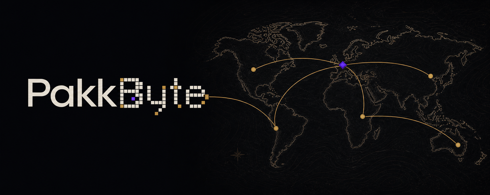

  

<h1 align="center">PakkByte</h1>

  <strong>Agentic AI Architecture</strong> 
  I design agents that plan, coordinate, and get real work done.

  
  
  
  

## What I build

- Solutions
  

[How PakkByte works →](./APPROACH.md)

## Working with PakkByte

The reusable workflow is documented here:

- [Repository conventions](./docs/operating-system/repository-conventions.md) — how repositories, Issues, branches, pull requests, and generated output are handled
- [Workstation recovery](./docs/operating-system/workstation-recovery.md) — how to resume work from any computer or a Codespace
- [Where does this belong?](./docs/operating-system/where-does-this-belong.md) — where source, tasks, decisions, evidence, and private material belong

## A good place to start

Start with the problem, even if the idea is still rough. 

- What isn’t working or takes too much time
- Who deals with it
- What a better outcome would look like
- Which tools, limits, or risks I should know about
  

[join the public discussion](https://github.com/PakkByte/PakkByte/discussions). 
> GitHub issues and discussions are public. Don’t include passwords, private information, or anything confidential.
